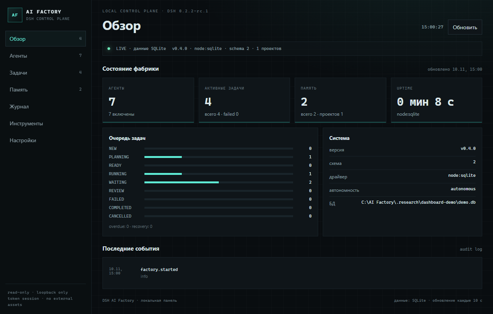

# DSH AI Factory

**AI Factory** — устанавливаемый плагин для DeepSeek Harness Desktop 0.2.2-rc.1,
который добавляет долговременную память, проектную привязку и фундамент для
автономной мультиагентной фабрики. Это настоящий host-плагин DSH: он
регистрирует инструменты через официальный `ctx.tools`, хранит данные в
локальном SQLite и переживает перезапуск приложения.

> Статус: **Phase 1–2c, dashboard v1, sync, REVIEWER и bounded workflow
> проверены на DSH**. Работают память, профили, Task Engine, Planner, DIRECTOR
> brief, реальный dispatch через `ctx.agents.create` с **enforced
> allowlist**, read-only dashboard, sync-сервер, Model Router с fallback,
> независимый REVIEWER и цикл dispatch → review → fix (до 5 циклов).
> Полный план — в [PLAN.md](PLAN.md).

## Что уже работает

- Устанавливается в профиль DSH как bundle-плагин (`dsh plugin add`).
- Загружается Cordis-загрузчиком DSH; в v0.17.0 регистрирует **36 инструментов**.
- Локальное SQLite-хранилище: `node:sqlite`, WAL, миграции по
  `PRAGMA user_version` (схема **v4**), FTS5-поиск с поддержкой русского текста.
- Память пяти типов: `working`, `episodic`, `semantic`, `project`, `user`.
- Проектная привязка по рабочему каталогу агента; глобальная пользовательская
  память.
- Дедупликация, версии, мягкое удаление, история изменений, TTL.
- Фильтр секретов: токены/ключи не попадают в память.
- **Agent Registry**: 7 встроенных профилей (DIRECTOR, RESEARCHER, DEVELOPER,
  SYSADMIN, ANALYST, EXECUTOR, REVIEWER) + пользовательские профили.
- **Task Engine**: статусы NEW…CANCELLED, приоритеты, зависимости, leases,
  heartbeat, retry с backoff, восстановление просроченных задач после сбоя,
  история событий.
- **Planner**: декомпозиция цели в DAG задач с назначением ролей; завершённая
  зависимость автоматически делает следующий шаг READY.
- **DIRECTOR brief**: фактическое состояние проекта, агентов, задач, памяти и
  следующие действия для главного агента.
- **Tool Registry**: `factory_tools_list` читает реальный реестр инструментов
  DSH, видимых текущему агенту.
- **Реальный dispatch + scoped allowlist**: `factory_dispatch` создаёт ребёнка
  через `ctx.agents.create` с `setup(restrict)` и runtime guard; ребёнок
  получает отдельную сессию, cwd проекта и только `allowedTools` профиля.
  `read`/`write`/`pwsh`/`run_code` дополнительно проверяются host-capability
  guard; RESEARCHER не имеет file-tools. Запрещённый вызов возвращает
  `TOOL_NOT_ALLOWED`.
- **Model Router**: маршрут профиль → родитель → `modelFallbacks`; fallback при ошибке child; audit `model.route`/`model.fallback`.
- **Autonomous workflow**: при `autoWorkflowEnabled` таймер находит READY-задачи и запускает bounded dispatch → review → fix через coordinator Agent; по умолчанию выключен.
- **Scoped profiles**: у каждого профиля явный `allowedTools`; DEVELOPER не
  имеет `factory_dispatch`, REVIEWER/RESEARCHER не имеют destructive-tools,
  SYSADMIN ограничен администрированием.
- **Dashboard v1**: локальная read-only панель (Overview, Agents, Tasks, Memory, Audit,
  Models, Sync, Tools, Settings) на 127.0.0.1, случайный токен, HttpOnly-cookie, без
  внешних ассетов и без мутаций.
- **Sync client/outbox + server**: локальный outbox и `factory_sync`
  (status/push/pull), HTTPS/loopback, токен из env, backoff; сервер
  `server/` на embedded PGlite или standalone PostgreSQL (`DATABASE_URL`)
  с pgvector, Bearer auth, direct TLS, idempotency, LWW/conflict и Docker
  Compose; реальный Ubuntu/Docker deploy ещё не выполнен. Локальный режим
  автономен.
- Аудит действий без записи содержимого памяти.
- 59 автотестов Vitest (миграции, память, агенты, задачи, planner, dispatch,
  dashboard, sync/auto-sync, reviewer/workflow, tool contract); отдельно
  5 тестов sync-сервера; строгая типизация TypeScript, сборка в `lib/`.
- Проверено в реальном Electron-процессе DSH: схема **v4**, 7 агентов, 35
  инструмента, audit `factory.started`; драйвер — `node:sqlite`.

## Инструменты

### Память и диагностика

| Инструмент | Назначение |
|---|---|
| `factory_status` | Состояние плагина, драйвер, схема, агенты, задачи, память |
| `factory_memory_remember` | Записать факт/решение/предпочтение с дедупликацией |
| `factory_memory_search` | FTS5-поиск по проекту и глобальной памяти |
| `factory_memory_get` | Прочитать запись по id |
| `factory_memory_update` | Исправить запись с историей версий |
| `factory_memory_forget` | Мягко удалить запись |
| `factory_memory_history` | История версий записи |
| `factory_memory_stats` | Статистика локального хранилища |

### Агенты

| Инструмент | Назначение |
|---|---|
| `factory_agent_list` | Профили специалистов, роли, доступ |
| `factory_agent_get` | Полный профиль по id |
| `factory_agent_save` | Создать или изменить профиль с версией |
| `factory_agent_toggle` | Включить/отключить профиль |

### Задачи

| Инструмент | Назначение |
|---|---|
| `factory_task_create` | Создать durable-задачу |
| `factory_task_list` / `get` | Список и чтение задач |
| `factory_task_update` | Изменить задачу до терминального статуса |
| `factory_task_claim` | Атомарно взять READY-задачу с lease |
| `factory_task_heartbeat` | Продлить lease |
| `factory_task_review` | Передать в REVIEW |
| `factory_task_complete` / `fail` | Завершить или зафиксировать ошибку |
| `factory_task_cancel` / `retry` | Отменить или вернуть FAILED в READY |
| `factory_task_recover` | Восстановить задачи с истёкшим lease |
| `factory_task_events` / `stats` | История и статистика |

### Оркестрация

| Инструмент | Назначение |
|---|---|
| `factory_plan_create` | DAG-план из шагов, ролей и зависимостей |
| `factory_director_brief` | Фактический брифинг для DIRECTOR |
| `factory_tools_list` | Реальные инструменты DSH, видимые агенту |
| `factory_dispatch` | Запустить дочернего агента через `ctx.agents` с allowlist и завершить задачу |
| `factory_dashboard` | Запустить/остановить локальную read-only панель и получить URL |
| `factory_sync` | status/push/pull памяти через outbox и sync-сервер |
| `factory_review` | Независимое ревью задачи child-агентом REVIEWER; FAIL создаёт fix-задачу |
| `factory_workflow_run` | Bounded-цикл dispatch → review → fix (до 5 циклов) |
| `factory_auto_workflow` | status/run/start/stop фонового auto workflow |
| `factory_model_route` | Read-only Model Router: primary, fallbacks, chain |

Память и задачи не являются «магическими»: модель должна вызывать инструменты.
Профили агентов — durable-конфигурация ролей. `factory_dispatch` создаёт
дочернюю сессию через `ctx.agents.create`; `setup` применяет allowlist профиля,
а глобальный tool guard возвращает `TOOL_NOT_ALLOWED` для любого вызова вне
списка. Оркестрационные инструменты (`factory_dispatch`, `factory_review`,
`factory_workflow_run`) дочерним профилям не выдаются.

### Dashboard

### Sync

`factory_sync` работает только при заданном `syncUrl` и переменной окружения
`syncTokenEnv` (по умолчанию `DSH_AI_FACTORY_SYNC_TOKEN`). Токен не хранится в
конфигурации. HTTP разрешён только для loopback; для внешнего сервера — HTTPS.
Операции памяти автоматически попадают в локальный `sync_outbox` (SQLite
triggers), при ошибке остаются там и повторяются с backoff. Pull использует
LWW по `updatedAt` и не создаёт обратный outbox.

Сервер: [server/README.md](server/README.md) — релизный архив
`dist/dsh-ai-factory-sync-server-0.17.0.tgz`; PGlite или standalone PostgreSQL
+ pgvector, Bearer auth, Docker Compose, backup endpoint, restore CLI,
scheduled backups.
Контракт:
[docs/sync-protocol.md](docs/sync-protocol.md).

Для автоматического flush/pull задайте `syncAuto: true` и
`syncIntervalSeconds` (минимум 15); таймер живёт только пока загружен плагин.

`factory_dashboard` запускает сервер только на `127.0.0.1` (порт 0 — свободный).
URL содержит одноразовый токен; после открытия токен превращается в
HttpOnly-cookie и исчезает из адресной строки. Панель read-only: GET‑запросы,
без внешних CDN, с CSP и `no-store`. Разделы: состояние, агенты, задачи,
память, журнал, инструменты, настройки. Остальные разделы ТЗ честно помечены
как `plan` в «Настройки → Подсистемы».



## Требования

- DeepSeek Harness Desktop **0.2.2-rc.1** (Desktop 44.7.0, Node 24.21).
- Профиль DSH (`desktop` по умолчанию).
- Windows 11 x64 — целевая платформа; код не содержит абсолютных путей и
  привязан к API версии DSH, а не к одному ПК.
- Для сборки из исходников: Node.js >= 22.19, pnpm.

## Установка из исходников

```powershell
git clone <repo-url> dsh-ai-factory
cd dsh-ai-factory
pnpm install
powershell -NoProfile -ExecutionPolicy Bypass -File scripts/install.ps1 -Profile desktop
```

Скрипт:

1. делает резервную копию `package.json`, `cordis.patch.yml` и lock-файла
   профиля;
2. собирает плагин (`pnpm --filter dsh-ai-factory build`);
3. устанавливает локальную ссылку через официальный `dsh plugin add`;
4. проверяет, что пакет и bundle-строка появились в профиле.

### Установка из релизного tarball

```powershell
pnpm run package:release
powershell -NoProfile -ExecutionPolicy Bypass -File scripts/install.ps1 `
  -Profile desktop -Tarball .\dist\dsh-ai-factory-0.17.0.tgz
```

Артефакт собирается без `node_modules`, проверяется по обязательным файлам и
имеет `SHA256SUMS`. Подробно — [docs/release.md](docs/release.md) и
[docs/portability.md](docs/portability.md).

Если DSH не применил новый bundle на лету, перезапустите приложение. После
запуска вызовите в чате:

> Вызови `factory_status` и покажи сырые поля.

Ожидаемый ответ: `status: ready`, `driver: node:sqlite`,
`schemaVersion: 4`, `agents: 7`.

### Установка на второй компьютер

Переносите **исходники**, а не `node_modules`. На втором ПК:

```powershell
git clone <repo-url> dsh-ai-factory
cd dsh-ai-factory
pnpm install
powershell -NoProfile -ExecutionPolicy Bypass -File scripts/install.ps1 -Profile desktop
```

Данные памяти лежат отдельно в `%USERPROFILE%\.dsh\ai-factory` и не входят в
git. Для переноса памяти используйте `scripts/backup.ps1` /
`scripts/restore.ps1`; для синхронизации между ПК — серверный этап (Phase 4).

## Конфигурация

Настройки задаются в `cordis.patch.yml` профиля по id `ai-factory`. Пример —
[config/examples/profile-patch.yml](config/examples/profile-patch.yml).
Основные поля:

| Поле | По умолчанию | Смысл |
|---|---|---|
| `dataDir` | `~/.dsh/ai-factory` | Каталог локальных данных |
| `dbFile` | `factory.db` | Имя SQLite-файла |
| `maxSearchResults` | `20` | Лимит результатов поиска |
| `workingMemoryTtlHours` | `72` | TTL рабочей памяти |
| `maxContentChars` | `100000` | Лимит одной записи |
| `allowGlobalMemory` | `true` | Разрешить глобальную память |
| `projectIdOverride` | `""` | Один project id для переносимого проекта |
| `redactLogs` | `true` | Редактировать секреты в аудите |
| `defaultAutonomy` | `autonomous` | Запасной уровень автономности |
| `syncAuto` | `false` | Автоматический push+pull |
| `syncIntervalSeconds` | `60` | Интервал auto-sync (мин. 15) |
| `modelRouterEnabled` | `true` | Model routing/fallback |
| `modelFallbacks` | `""` | Fallback-маршруты `provider/model` через запятую |
| `modelMaxAttempts` | `2` | Максимум model-попыток (1–3) |
| `autoWorkflowEnabled` | `false` | Фоновый bounded workflow |
| `autoWorkflowIntervalSeconds` | `120` | Интервал скана (мин. 30) |
| `autoWorkflowMaxCycles` | `2` | Циклов на задачу |
| `autoWorkflowMaxTasks` | `1` | Задач за tick |

Секреты в конфигурации не хранятся. API-ключи DSH остаются в его credential
service.

## Данные и приватность

- По умолчанию: `%USERPROFILE%\.dsh\ai-factory\factory.db` (+ WAL).
- Каталог создаётся с ограниченными правами (на POSIX — `0700`).
- Память привязана к проекту по canonical path рабочего каталога агента.
  `projectIdOverride` позволяет использовать один id на разных ПК.
- В память не пишутся секреты; при обнаружении ключа инструмент возвращает
  ошибку `SECRET_DETECTED`.
- Аудит хранит метаданные (id, тип, результат), но не текст памяти.
- Удаление плагина не удаляет данные; для очистки нужен явный
  `scripts/uninstall.ps1 -PurgeData`.

## Разработка

```powershell
pnpm install
pnpm typecheck
pnpm test
pnpm build
```

Тесты не требуют запущенного DSH. Они используют временные SQLite-базы и
проверяют миграции v1→v2, FTS5, дедупликацию, версии, TTL, фильтр секретов,
реестр агентов, зависимости задач, lease/retry/recovery, planner и регистрацию
инструментов через фейковый Cordis-контекст.

Структура:

```
plugin/                 устанавливаемый npm-пакет
  src/core/             ошибки, id, JSON, безопасность, workspace
  src/storage/          SQLite и миграции v1/v2
  src/memory/           Memory Engine и инструменты
  src/agents/           профили специалистов и реестр
  src/tasks/            Task Engine, статусы, lease, recovery
  src/planner/          DAG-планировщик
  src/orchestration/    DIRECTOR brief и реестр инструментов
  src/agents/scoped-runner.ts  ctx.agents.create + allowlist setup
src/dispatch/         запуск дочернего агента через scoped runner
  src/dashboard/        локальный read-only HTTP dashboard
  src/projects/         проектный реестр
  src/tools/            диагностика
  tests/                Vitest
docs/                   DISCOVERY, ARCHITECTURE, PLAN, отчёты
scripts/                install / uninstall / backup / restore / doctor
config/                 примеры конфигурации
```

## Ограничения текущей фазы

- Нет семантического поиска на embeddings: сейчас честный FTS5/BM25;
  векторный поиск появится вместе с pgvector (Phase 4).
- Нет автоматической инъекции памяти в промпт: инструменты вызываются моделью.
- Allowlist enforced для child-агентов; Model Router/fallback реализованы,
  но маршруты не валидируются по каталогу провайдера заранее.
- Guard проверяет вызовы через `ctx.tools`; host-возможности вне этого реестра
  требуют отдельного аудита.
- Dashboard v1 — read-only и не содержит Workflows/KB/Models/Scheduler/
  Security/Server/GitHub разделов; они честно помечены как `plan`.
- Workflow ограничен `maxCycles` 1–5; неограниченного автономного цикла и
  GitHub Release нет. Серверная синхронизация работает на PGlite или standalone PostgreSQL.
- `node:sqlite` помечен в Node 24 как experimental. Плагин проверяет драйвер и
  сообщает об ошибке; в DSH 0.2.2-rc.1 он проверен и работает.
- HMR-применение нового bundle зависит от настроек профиля; если плагин не
  появился — перезапустите DSH.

## Документация

- [DISCOVERY.md](docs/DISCOVERY.md) — факты о DSH и API.
- [ARCHITECTURE.md](docs/ARCHITECTURE.md) — архитектура и границы модулей.
- [PLAN.md](PLAN.md) — этапы и критерии.
- [PROGRESS.md](PROGRESS.md) — текущий прогресс.
- [TEST_REPORT.md](TEST_REPORT.md) — результаты проверок.
- [SECURITY.md](SECURITY.md) — модель угроз и правила.
- [release.md](docs/release.md) — сборка, tarball, GitHub Release.
- [portability.md](docs/portability.md) — установка на второй ПК.
- [sync-protocol.md](docs/sync-protocol.md) — контракт sync-сервера и outbox.
- [SCOPED_TOOLS.md](docs/SCOPED_TOOLS.md)
- [LIVE_SMOKE.md](docs/LIVE_SMOKE.md) — живой smoke v0.7.0 в Web GUI.
- [server/README.md](server/README.md) — запуск sync-сервера.

## Лицензия

MIT. См. [LICENSE](LICENSE).
